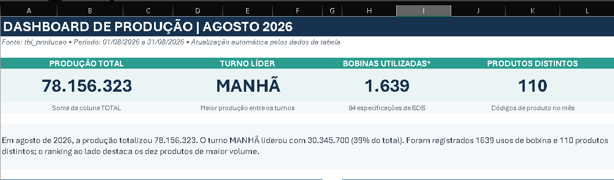
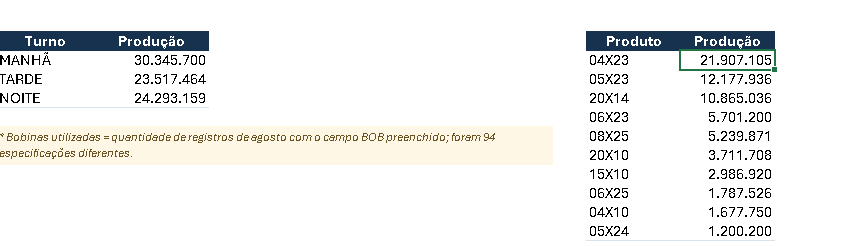
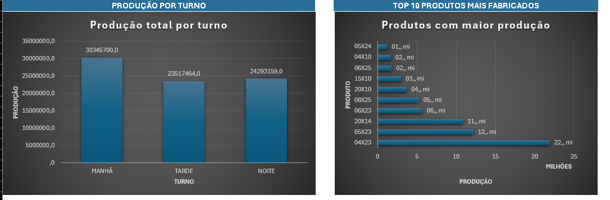
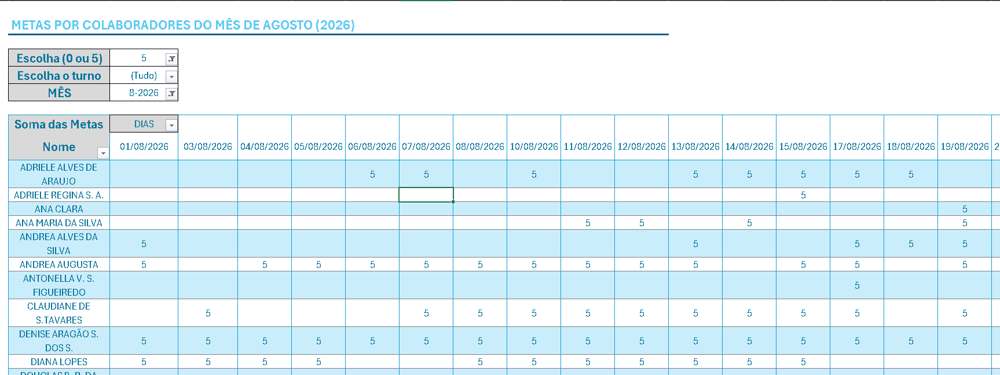

# Dashboard de Produção

## 📊 Visão Geral

Este projeto apresenta um **Dashboard de Produção** desenvolvido em Microsoft Excel com foco na organização, monitorização e visualização de dados operacionais. O objetivo é transformar dados brutos em informações visuais claras e acionáveis, facilitando a análise do desempenho produtivo e apoiando a tomada de decisões baseadas em dados.

---

## 🎯 Objetivos do Projeto

- Centralizar indicadores de produção em um único painel.
- Melhorar a visibilidade dos processos produtivos.
- Facilitar a análise de desempenho em tempo real.
- Apoiar decisões estratégicas através de métricas e indicadores.
- Reduzir o tempo gasto na análise manual de dados.

---

## 🚀 Principais Funcionalidades

- Dashboard interativo em Excel.
- Indicadores de produtividade.
- Gráficos dinâmicos.
- Filtros para análise segmentada.
- Acompanhamento de metas e resultados.
- Visualização simplificada de KPIs.

---

## 🛠️ Tecnologias Utilizadas

- Microsoft Excel
- Tabelas Dinâmicas
- Gráficos Dinâmicos
- Fórmulas Avançadas
- Formatação Condicional
- Power Query (se aplicável)
- VBA (se aplicável)

---

## 📸 Imagens do Projeto

### Página Inicial do Dashboard

> Inserir captura de ecrã da visão geral.



---

### Indicadores de Produção

> Inserir captura de ecrã dos principais indicadores e KPIs.



---

### Análise de Desempenho

> Inserir captura de ecrã dos gráficos e análises.



---

### Filtros e Interatividade

> Inserir captura de ecrã dos segmentadores de dados.



---

## 📈 Indicadores Monitorizados

- Produção total
- Eficiência operacional
- Cumprimento de metas
- Produtividade por período
- Taxa de retrabalho
- Tempo de produção
- Desempenho por equipa ou setor

---

## 📂 Estrutura do Projeto

```text
Dashboard-Producao/
│
├── Dashboard_Producao.xlsx
├── README.md
└── images/
    ├── dashboard-principal.png
    ├── kpis-producao.png
    ├── analise-desempenho.png
    └── filtros-dashboard.png
```

---

## ✅ Benefícios

- Melhor acompanhamento da operação.
- Maior rapidez na tomada de decisões.
- Redução de erros de análise.
- Visualização intuitiva dos resultados.
- Gestão orientada por indicadores.

---

## 👨‍💻 Autor

Jeferson Gomes
LINKEDIN: www.linkedin.com/in/jeferson-gomes
